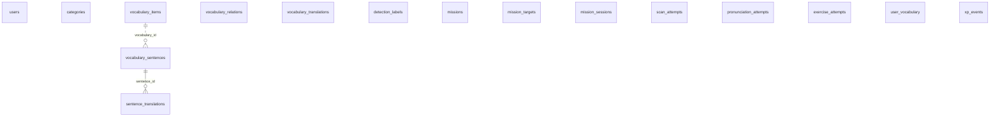

# ERD Fase 8 — draf parsial, menunggu DDL sumber

Status 16 Oktober 2026: belum merupakan ERD atau schema database final.
Pencarian rg -n -i 'create\s+table' docs tidak menemukan DDL.
Dokumen Rencana Fullstack dan v2 juga belum tersedia di repo.

Lampiran prompt merinci kolom lengkap untuk tiga tabel. Tiga belas tabel lainnya
memerlukan DDL dasar; penambahan beberapa kolom bukan pengganti definisi tabel.
Sesuai instruksi, schema.prisma dan migrasi tidak dibuat dengan menebak kolom.
server/.env belum ada; koneksi MySQL dan charset utf8mb4 belum diverifikasi.

## Diagram parsial

Diagram mencantumkan 16 nama tabel yang diwajibkan, tetapi hanya dua relasi yang
sudah memiliki kolom dan nullability eksplisit. Entitas tanpa relasi merupakan
penanda tabel yang masih menunggu DDL, bukan pernyataan bahwa tabel itu tanpa FK.
Sintaks entitas mandiri mengikuti [dokumentasi Mermaid](https://mermaid.js.org/syntax/entityRelationshipDiagram.html#entities-and-relationships).

Dua FK dari vocabulary_relations ke vocabulary_items disebut di prompt, tetapi
nama kolom, nullability, dan constraint-nya menunggu DDL; relasi itu belum digambar.
Tidak ada FK lain yang disimpulkan dari nama kolom, termasuk pada exercise_attempts.

## Daftar 16 tabel

### users

Model User memetakan users; seluruh kolom dan FK menunggu DDL sumber.

### categories

Model Category memetakan categories; seluruh kolom dan FK menunggu DDL sumber.

### vocabulary_items

Model VocabularyItem memetakan vocabulary_items; seluruh kolom dan FK menunggu DDL sumber.

### vocabulary_relations

Model VocabularyRelation memetakan vocabulary_relations; DDL diperlukan untuk kolom dan dua relasi bernama eksplisit ke vocabulary_items.

### vocabulary_translations

Model VocabularyTranslation memetakan vocabulary_translations; DDL dasar belum tersedia, dengan tambahan wajib romanization VARCHAR(80) NULL dan reviewed TINYINT(1) NOT NULL DEFAULT 0.

### vocabulary_sentences

Model VocabularySentence memetakan vocabulary_sentences; prompt memberikan seluruh kolom berikut beserta FK vocabulary_id ke vocabulary_items.

| Kolom         | Definisi SQL dari prompt                |
| ------------- | --------------------------------------- |
| id            | INT AUTO_INCREMENT PRIMARY KEY          |
| vocabulary_id | INT NOT NULL, FK ke vocabulary_items    |
| kind          | ENUM('choice','cloze','order') NOT NULL |
| sentence_en   | VARCHAR(160) NOT NULL                   |
| blank_word    | VARCHAR(60) NULL                        |
| words_json    | JSON NULL                               |
| difficulty    | TINYINT NOT NULL DEFAULT 1              |
| source        | VARCHAR(40) NOT NULL DEFAULT 'own'      |
| source_ref    | VARCHAR(40) NULL                        |
| author        | VARCHAR(80) NULL                        |
| license       | VARCHAR(40) NOT NULL DEFAULT 'own'      |

### sentence_translations

Model SentenceTranslation memetakan sentence_translations; prompt memberikan seluruh kolom berikut dengan PRIMARY KEY (sentence_id, language_code).

| Kolom         | Definisi SQL dari prompt                 |
| ------------- | ---------------------------------------- |
| sentence_id   | INT NOT NULL, FK ke vocabulary_sentences |
| language_code | CHAR(5) NOT NULL                         |
| text          | VARCHAR(255) NOT NULL                    |
| pinyin        | VARCHAR(255) NULL                        |
| source        | VARCHAR(40) NOT NULL                     |
| source_ref    | VARCHAR(40) NULL                         |
| author        | VARCHAR(80) NULL                         |
| license       | VARCHAR(40) NOT NULL                     |
| reviewed      | TINYINT(1) NOT NULL DEFAULT 0            |

### detection_labels

Model DetectionLabel memetakan detection_labels; seluruh kolom dan FK menunggu DDL sumber.

### missions

Model Mission memetakan missions; DDL dasar belum tersedia, dengan tambahan wajib exercise_plan JSON NOT NULL dan practice_xp INT NOT NULL DEFAULT 30.

### mission_targets

Model MissionTarget memetakan mission_targets; seluruh kolom dan FK menunggu DDL sumber.

### mission_sessions

Model MissionSession memetakan mission_sessions; DDL dasar belum tersedia, dengan tambahan wajib practice_accuracy INT NULL, speak_score INT NULL, session_score INT NULL, dan result_json JSON NULL.

### scan_attempts

Model ScanAttempt memetakan scan_attempts; seluruh kolom dan FK menunggu DDL sumber.

### pronunciation_attempts

Model PronunciationAttempt memetakan pronunciation_attempts; DDL dasar belum tersedia, dengan tambahan wajib sentence_id INT NULL tanpa mengasumsikan FK.

### exercise_attempts

Model ExerciseAttempt memetakan exercise_attempts; prompt memberikan seluruh kolom berikut dan UNIQUE uq_attempt (session_id, sentence_id, attempt_no).

| Kolom       | Definisi SQL dari prompt                    |
| ----------- | ------------------------------------------- |
| id          | INT AUTO_INCREMENT PRIMARY KEY              |
| session_id  | CHAR(36) NOT NULL                           |
| sentence_id | INT NOT NULL                                |
| kind        | ENUM('choice','cloze','order') NOT NULL     |
| attempt_no  | TINYINT NOT NULL                            |
| answer      | VARCHAR(255) NOT NULL                       |
| is_correct  | TINYINT(1) NOT NULL                         |
| value       | DECIMAL(2,1) NOT NULL                       |
| created_at  | DATETIME NOT NULL DEFAULT CURRENT_TIMESTAMP |

### user_vocabulary

Model UserVocabulary memetakan user_vocabulary; seluruh kolom dan FK menunggu DDL sumber.

### xp_events

Model XpEvent memetakan xp_events; seluruh kolom dan FK menunggu DDL sumber.

## Syarat melanjutkan

Sediakan DDL dasar untuk: users, categories, vocabulary_items, vocabulary_relations,
vocabulary_translations, detection_labels, missions, mission_targets, mission_sessions,
scan_attempts, pronunciation_attempts, user_vocabulary, dan xp_events.

Setelah DDL tersedia, lengkapi schema Prisma 6 dengan pemetaan snake_case, enum
SentenceKind bersama, tipe sesuai prompt, dan hanya FK dari sumber.
Aksi hapus mengikuti Restrict yang diminta; waktu disimpan UTC.
Validasi dan verifikasi utf8mb4 harus mendahului migrasi.

Belum dijalankan: prisma format/validate, migrate dev, generate, migrate reset,
migrate deploy, daftar/definisi tabel di MySQL, dan pemeriksaan charset MySQL.
Tidak ada migrasi init yang dibuat dan tidak ada data database yang diubah.
